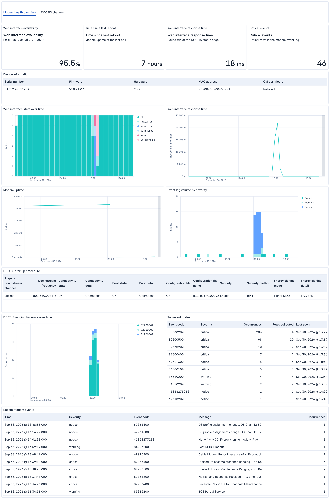
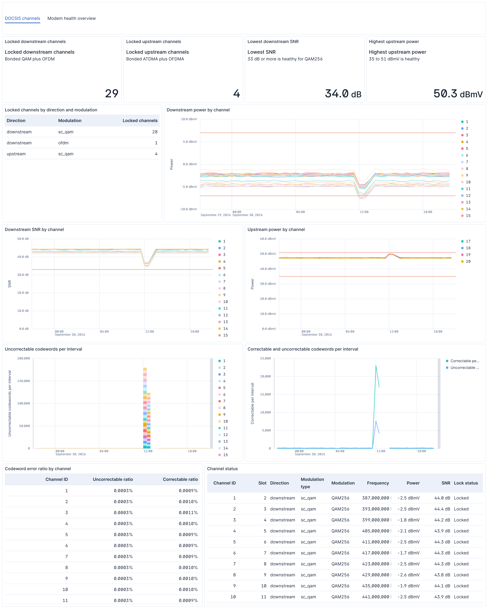

<!-- NOTICE: Do not edit this file manually.-->
<!-- This file is automatically generated by Elastic Package -->

# NETGEAR Genie

## Overview

The NETGEAR Genie integration collects the event log, the DOCSIS
channel table and the device status from a NETGEAR cable modem that serves the
Genie web interface, and turns them into logs, metrics and dashboards.

A cable modem is normally a black box: when the connection degrades there is
nothing to look at afterwards, because the only record lives on a web page that
is overwritten as the modem runs. This integration polls that web interface on a
schedule and keeps the result, so a problem that happened overnight is still
there in the morning, with the channel power, signal to noise ratio and codeword
error counts that go with it.

The integration collects:

- **Event log**: the modem's DOCSIS event table, one document per logged event,
  with the severity, the DOCSIS event code and the text split out.
- **DOCSIS channels**: the downstream and upstream bonded channel table, one
  document per channel per poll, with lock status, frequency, power, signal to
  noise ratio and codeword counters.
- **Modem status**: the DOCSIS startup procedure, the device identity, the
  modem's uptime, and the reachability of the web interface itself.

### How it works

The modem has no API, no SNMP and no syslog export, so the integration signs in
to the web interface the same way a browser does and scrapes the pages. Each
poll fetches the login page for its one-time token, posts the credentials, and
then reads the page it needs.

The modem allows only **one web interface session at a time**. While the
integration holds the session, signing in from a browser takes it away, and the
next poll takes it back. See [Take over the modem web session](#settings) below.

### Health of the web interface itself

Every poll of the **Modem status** data stream writes a document, including the
polls that fail. A poll that could not reach the modem, could not sign in, or
was answered with the login page instead of the page it asked for is recorded
with `netgear_genie.status.web_ui.state` set to one of:

| State | Meaning |
| --- | --- |
| `ok` | The web interface answered and the status page was collected. |
| `unreachable` | The modem did not answer at all. |
| `http_error` | The modem answered with an HTTP error. |
| `auth_failed` | The modem rejected the credentials. |
| `session_conflict` | Another device holds the modem's single web session. |
| `session_stuck` | The modem accepted the sign in but still answers protected pages with the login page. |

`session_stuck` is worth calling out. This firmware family can get into a state
where the web interface accepts a login, redirects as though it succeeded, and
then serves the login page for every request, indefinitely. The modem keeps
passing traffic the whole time, so nothing else notices. A failed poll becoming
a document rather than a gap is what makes that state visible, and what lets an
alert fire on it.

## Compatibility

Developed against a NETGEAR CM1000v2 on firmware `V10.01.07`. Other NETGEAR
cable modems that serve the same Genie web interface are likely to work, since
the pages and the sign-in flow are shared across the firmware family, but they
have not been tested.

This integration reads the modem's web interface over plain HTTP. The modem does
not offer HTTPS, SSH or SNMP.

## Requirements

- An Elastic Agent that can reach the modem's web interface over HTTP. The
  modem is usually at `http://192.168.100.1`, which it answers on even when it
  is in bridge mode and the rest of the network is behind a router.
- The modem's web interface username and password. NETGEAR ships these as
  `admin` / `password`; change them on the modem if you have not already.

## Setup

1. In Kibana, go to **Management > Integrations**, search for **NETGEAR
   Genie** and select **Add NETGEAR Genie**.
2. Set **Modem URL**, **Username** and **Password**.
3. Enable the data streams you want and adjust their poll intervals.
4. Assign the policy to the agent that can reach the modem.

### Settings

| Setting | Default | Notes |
| --- | --- | --- |
| Modem URL | `http://192.168.100.1` | Base URL of the web interface. |
| Username / Password | `admin` | Web interface credentials. The password is stored as a secret. |
| HTTP Client Timeout | `30s` | The modem's web server is slow; several seconds per page is normal. |
| Interval | `5m` | Per data stream. See the note below before lowering it. |
| Take over the modem web session | | The modem permits one session at a time. When enabled, a poll that finds another device holding the session takes it over, which signs that device out. Leave it off if you want the integration to stand aside and report `session_conflict` instead. |
| Time zone offset | `UTC` | The modem reports event times with no time zone. Set this to the modem's local time zone if it is not UTC, or event timestamps will be shifted. |

**Choosing an interval.** Each poll is a full sign-in plus a page fetch against
a small embedded web server, and each enabled data stream polls independently.
Five minutes per data stream is a reasonable default. Polling much more often
gives the modem little time to do anything else, and because the modem allows
only one session, it also means a browser session is being displaced more often.

## Data streams

### Event log

The modem's DOCSIS event table, from `/EventLog.asp`. Rows are aggregated in
place by the modem: a repeating event keeps one row and bumps its occurrence
count and last-seen time rather than adding a new row. The integration emits a
row when it is new or when its count or last-seen time changes, and gives each
one a deterministic document ID, so a row that is collected twice is written
over itself instead of duplicated.

Events the modem logged before it had learned the time of day carry the literal
`Time Not Established` instead of a timestamp. Those documents keep their
collection time as `@timestamp` and are tagged `time_not_established`, so a
stand-in timestamp can be told apart from a real event time.

An example event for `event_log` looks as following:

```json
{
    "@timestamp": "2026-08-31T07:56:40.000Z",
    "agent": {
        "ephemeral_id": "4d04b0c3-9e26-4b39-91df-c012212910ab",
        "id": "8b957710-1a18-483a-a9cf-844e90a8a102",
        "name": "elastic-agent-64415",
        "type": "filebeat",
        "version": "9.4.3"
    },
    "data_stream": {
        "dataset": "netgear_genie.event_log",
        "namespace": "46308",
        "type": "logs"
    },
    "ecs": {
        "version": "9.3.0"
    },
    "elastic_agent": {
        "id": "8b957710-1a18-483a-a9cf-844e90a8a102",
        "snapshot": false,
        "version": "9.4.3"
    },
    "event": {
        "agent_id_status": "verified",
        "category": [
            "network"
        ],
        "code": "69010200",
        "dataset": "netgear_genie.event_log",
        "end": "2026-08-31T07:56:40.000Z",
        "ingested": "2026-09-22T21:18:00Z",
        "kind": "event",
        "module": "netgear_genie",
        "original": "{\"count\":\"1\",\"first_time\":\"2026-08-31, 07:56:40\",\"id\":\"69010200\",\"index\":\"9\",\"last_time\":\"2026-08-31, 07:56:40\",\"level\":\"Notice (6)\",\"text\":\"Cable Modem Reboot because of - 'Reboot UI' \\u0026 power cycle;CM-MAC=00:00:5e:00:53:01;CMTS-MAC=00:00:00:00:00:00;CM-QOS=1.1;CM-VER=3.1;\"}",
        "severity": 6,
        "start": "2026-08-31T07:56:40.000Z",
        "timezone": "UTC",
        "type": [
            "info"
        ]
    },
    "input": {
        "type": "cel"
    },
    "log": {
        "level": "notice"
    },
    "message": "Cable Modem Reboot because of - 'Reboot UI' & power cycle",
    "netgear_genie": {
        "event_log": {
            "cm_mac": "00:00:5e:00:53:01",
            "cm_qos": "1.1",
            "cm_ver": "3.1",
            "cmts_mac": "00:00:00:00:00:00",
            "count": 1,
            "index": 9
        }
    },
    "observer": {
        "mac": [
            "00-00-5E-00-53-01"
        ],
        "type": "modem",
        "vendor": "NETGEAR"
    },
    "tags": [
        "preserve_original_event",
        "forwarded",
        "netgear_genie-event_log"
    ]
}
```

**Exported fields**

| Field | Description | Type |
|---|---|---|
| @timestamp | Date/time when the event originated. This is the date/time extracted from the event, typically representing when the event was generated by the source. If the event source has no original timestamp, this value is typically populated by the first time the event was received by the pipeline. Required field for all events. | date |
| data_stream.dataset | The field can contain anything that makes sense to signify the source of the data. Examples include `nginx.access`, `prometheus`, `endpoint` etc. For data streams that otherwise fit, but that do not have dataset set we use the value "generic" for the dataset value. `event.dataset` should have the same value as `data_stream.dataset`. Beyond the Elasticsearch data stream naming criteria noted above, the `dataset` value has additional restrictions:   \* Must not contain `-`   \* No longer than 100 characters | constant_keyword |
| data_stream.namespace | A user defined namespace. Namespaces are useful to allow grouping of data. Many users already organize their indices this way, and the data stream naming scheme now provides this best practice as a default. Many users will populate this field with `default`. If no value is used, it falls back to `default`. Beyond the Elasticsearch index naming criteria noted above, `namespace` value has the additional restrictions:   \* Must not contain `-`   \* No longer than 100 characters | constant_keyword |
| data_stream.type | An overarching type for the data stream. Currently allowed values are "logs" and "metrics". We expect to also add "traces" and "synthetics" in the near future. | constant_keyword |
| ecs.version | ECS version this event conforms to. `ecs.version` is a required field and must exist in all events. When querying across multiple indices -- which may conform to slightly different ECS versions -- this field lets integrations adjust to the schema version of the events. | keyword |
| error.message | Error message. | match_only_text |
| event.category | This is one of four ECS Categorization Fields, and indicates the second level in the ECS category hierarchy. `event.category` represents the "big buckets" of ECS categories. For example, filtering on `event.category:process` yields all events relating to process activity. This field is closely related to `event.type`, which is used as a subcategory. This field is an array. This will allow proper categorization of some events that fall in multiple categories. | keyword |
| event.code | Identification code for this event, if one exists. Some event sources use event codes to identify messages unambiguously, regardless of message language or wording adjustments over time. An example of this is the Windows Event ID. | keyword |
| event.dataset | Name of the dataset. If an event source publishes more than one type of log or events (e.g. access log, error log), the dataset is used to specify which one the event comes from. It's recommended but not required to start the dataset name with the module name, followed by a dot, then the dataset name. | constant_keyword |
| event.end | `event.end` contains the date when the event ended or when the activity was last observed. | date |
| event.kind | This is one of four ECS Categorization Fields, and indicates the highest level in the ECS category hierarchy. `event.kind` gives high-level information about what type of information the event contains, without being specific to the contents of the event. For example, values of this field distinguish alert events from metric events. The value of this field can be used to inform how these kinds of events should be handled. They may warrant different retention, different access control, it may also help understand whether the data is coming in at a regular interval or not. | keyword |
| event.module | Name of the module this data is coming from. If your monitoring agent supports the concept of modules or plugins to process events of a given source (e.g. Apache logs), `event.module` should contain the name of this module. | constant_keyword |
| event.original | Raw text message of entire event. Used to demonstrate log integrity or where the full log message (before splitting it up in multiple parts) may be required, e.g. for reindex. This field is not indexed and doc_values are disabled. It cannot be searched, but it can be retrieved from `_source`. If users wish to override this and index this field, please see `Field data types` in the `Elasticsearch Reference`. | keyword |
| event.severity | The numeric severity of the event according to your event source. What the different severity values mean can be different between sources and use cases. It's up to the implementer to make sure severities are consistent across events from the same source. The Syslog severity belongs in `log.syslog.severity.code`. `event.severity` is meant to represent the severity according to the event source (e.g. firewall, IDS). If the event source does not publish its own severity, you may optionally copy the `log.syslog.severity.code` to `event.severity`. | long |
| event.start | `event.start` contains the date when the event started or when the activity was first observed. | date |
| event.timezone | This field should be populated when the event's timestamp does not include timezone information already (e.g. default Syslog timestamps). It's optional otherwise. Acceptable timezone formats are: a canonical ID (e.g. "Europe/Amsterdam"), abbreviated (e.g. "EST") or an HH:mm differential (e.g. "-05:00"). | keyword |
| event.type | This is one of four ECS Categorization Fields, and indicates the third level in the ECS category hierarchy. `event.type` represents a categorization "sub-bucket" that, when used along with the `event.category` field values, enables filtering events down to a level appropriate for single visualization. This field is an array. This will allow proper categorization of some events that fall in multiple event types. | keyword |
| input.type | Type of filebeat input. | keyword |
| log.level | Original log level of the log event. If the source of the event provides a log level or textual severity, this is the one that goes in `log.level`. If your source doesn't specify one, you may put your event transport's severity here (e.g. Syslog severity). Some examples are `warn`, `err`, `i`, `informational`. | keyword |
| log.offset | Log offset. | long |
| message | For log events the message field contains the log message, optimized for viewing in a log viewer. For structured logs without an original message field, other fields can be concatenated to form a human-readable summary of the event. If multiple messages exist, they can be combined into one message. | match_only_text |
| netgear_genie.event_log.cm_mac | Cable modem MAC address reported in the event text (CM-MAC), as reported by the modem. | keyword |
| netgear_genie.event_log.cm_qos | DOCSIS QoS version reported in the event text (CM-QOS). | keyword |
| netgear_genie.event_log.cm_ver | DOCSIS version of the cable modem reported in the event text (CM-VER). | keyword |
| netgear_genie.event_log.cmts_mac | Cable modem termination system (CMTS) MAC address reported in the event text (CMTS-MAC). All zeros when the CMTS is not known. | keyword |
| netgear_genie.event_log.count | Number of times this event was logged between the first and last time (docsDevEvCounts). The modem aggregates repeated events into a single row. | long |
| netgear_genie.event_log.index | Position of the row in the modem event table (docsDevEvIndex). 1 is the newest row; the index shifts as new events are logged. | long |
| observer.mac | MAC addresses of the observer. The notation format from RFC 7042 is suggested: Each octet (that is, 8-bit byte) is represented by two [uppercase] hexadecimal digits giving the value of the octet as an unsigned integer. Successive octets are separated by a hyphen. | keyword |
| observer.type | The type of the observer the data is coming from. There is no predefined list of observer types. Some examples are `forwarder`, `firewall`, `ids`, `ips`, `proxy`, `poller`, `sensor`, `APM server`. | keyword |
| observer.vendor | Vendor name of the observer. | constant_keyword |
| tags | List of keywords used to tag each event. | keyword |


### DOCSIS channels

The downstream and upstream bonded channel table, from `/DocsisStatus.asp`. One
document per channel per poll.

The codeword counters (`unerrored_codewords`, `correctable_codewords`,
`uncorrectable_codewords`) are cumulative totals that the modem resets when it
reboots. Chart the change between polls rather than the raw value.

An example event for `channel` looks as following:

```json
{
    "@timestamp": "2026-09-22T21:19:47.809637500Z",
    "agent": {
        "ephemeral_id": "19aac2ae-d44d-49b7-89cb-81c1b955a5dd",
        "id": "0f9b8ea0-ead3-4773-8be1-d181128f9021",
        "name": "elastic-agent-49925",
        "type": "filebeat",
        "version": "9.4.3"
    },
    "data_stream": {
        "dataset": "netgear_genie.channel",
        "namespace": "56934",
        "type": "metrics"
    },
    "ecs": {
        "version": "9.3.0"
    },
    "elastic_agent": {
        "id": "0f9b8ea0-ead3-4773-8be1-d181128f9021",
        "snapshot": false,
        "version": "9.4.3"
    },
    "event": {
        "agent_id_status": "verified",
        "dataset": "netgear_genie.channel",
        "ingested": "2026-09-22T21:19:47Z",
        "kind": "metric",
        "original": "{\"channel\":\"1\",\"channel_id\":\"25\",\"correctable_codewords\":\"529\",\"frequency\":\"801000000 Hz\",\"lock_status\":\"Locked\",\"modulation\":\"QAM256\",\"modulation_type\":\"sc_qam\",\"power\":\"-4.9 dBmV\",\"snr\":\"42.3 dB\",\"type\":\"downstream\",\"uncorrectable_codewords\":\"1334\",\"unerrored_codewords\":\"4077504903\"}"
    },
    "input": {
        "type": "cel"
    },
    "netgear_genie": {
        "channel": {
            "channel": 1,
            "channel_id": 25,
            "correctable_codewords": 529,
            "frequency": 801000000,
            "lock_status": "Locked",
            "locked": true,
            "modulation": "QAM256",
            "modulation_type": "sc_qam",
            "power": -4.9,
            "snr": 42.3,
            "type": "downstream",
            "uncorrectable_codewords": 1334,
            "unerrored_codewords": 4077504903
        }
    },
    "observer": {
        "type": "modem",
        "vendor": "NETGEAR"
    },
    "tags": [
        "preserve_original_event",
        "forwarded",
        "netgear_genie-channel"
    ]
}
```

**Exported fields**

| Field | Description | Type | Metric Type |
|---|---|---|---|
| @timestamp | Date/time when the event originated. This is the date/time extracted from the event, typically representing when the event was generated by the source. If the event source has no original timestamp, this value is typically populated by the first time the event was received by the pipeline. Required field for all events. | date |  |
| data_stream.dataset | The field can contain anything that makes sense to signify the source of the data. Examples include `nginx.access`, `prometheus`, `endpoint` etc. For data streams that otherwise fit, but that do not have dataset set we use the value "generic" for the dataset value. `event.dataset` should have the same value as `data_stream.dataset`. Beyond the Elasticsearch data stream naming criteria noted above, the `dataset` value has additional restrictions:   \* Must not contain `-`   \* No longer than 100 characters | constant_keyword |  |
| data_stream.namespace | A user defined namespace. Namespaces are useful to allow grouping of data. Many users already organize their indices this way, and the data stream naming scheme now provides this best practice as a default. Many users will populate this field with `default`. If no value is used, it falls back to `default`. Beyond the Elasticsearch index naming criteria noted above, `namespace` value has the additional restrictions:   \* Must not contain `-`   \* No longer than 100 characters | constant_keyword |  |
| data_stream.type | An overarching type for the data stream. Currently allowed values are "logs" and "metrics". We expect to also add "traces" and "synthetics" in the near future. | constant_keyword |  |
| ecs.version | ECS version this event conforms to. `ecs.version` is a required field and must exist in all events. When querying across multiple indices -- which may conform to slightly different ECS versions -- this field lets integrations adjust to the schema version of the events. | keyword |  |
| error.message | Error message. | match_only_text |  |
| event.dataset | Name of the dataset. If an event source publishes more than one type of log or events (e.g. access log, error log), the dataset is used to specify which one the event comes from. It's recommended but not required to start the dataset name with the module name, followed by a dot, then the dataset name. | constant_keyword |  |
| event.kind | This is one of four ECS Categorization Fields, and indicates the highest level in the ECS category hierarchy. `event.kind` gives high-level information about what type of information the event contains, without being specific to the contents of the event. For example, values of this field distinguish alert events from metric events. The value of this field can be used to inform how these kinds of events should be handled. They may warrant different retention, different access control, it may also help understand whether the data is coming in at a regular interval or not. | keyword |  |
| event.module | Name of the module this data is coming from. If your monitoring agent supports the concept of modules or plugins to process events of a given source (e.g. Apache logs), `event.module` should contain the name of this module. | constant_keyword |  |
| event.original | Raw text message of entire event. Used to demonstrate log integrity or where the full log message (before splitting it up in multiple parts) may be required, e.g. for reindex. This field is not indexed and doc_values are disabled. It cannot be searched, but it can be retrieved from `_source`. If users wish to override this and index this field, please see `Field data types` in the `Elasticsearch Reference`. | keyword |  |
| input.type | Type of filebeat input. | keyword |  |
| log.offset | Log offset. | long |  |
| netgear_genie.channel.channel | Position of the channel in the modem's channel table. Every slot is reported on every poll; unused slots are reported as not locked with zero values. | long |  |
| netgear_genie.channel.channel_id | DOCSIS channel identifier assigned by the CMTS. Zero when the channel is not locked. | long |  |
| netgear_genie.channel.correctable_codewords | Codewords received with errors that forward error correction was able to correct, since the modem booted. | long | counter |
| netgear_genie.channel.frequency | Center frequency of the channel in hertz. Zero when the channel is not locked. | long | gauge |
| netgear_genie.channel.lock_status | Lock status of the channel as reported by the modem, for example `Locked` or `Not Locked`. | keyword |  |
| netgear_genie.channel.locked | Whether the channel is locked. True when the modem reports the lock status as `Locked`. Count this field to chart how many of the modem's channel slots are in use. | boolean |  |
| netgear_genie.channel.modulation | Modulation of a single carrier QAM channel, for example `QAM256` or `ATDMA`. Reported as `Unknown` on unused slots. Not present on OFDM and OFDMA channels. | keyword |  |
| netgear_genie.channel.modulation_type | Channel type, derived from the table the row was read from. One of `sc_qam` (DOCSIS 3.0 bonded channel), `ofdm` (DOCSIS 3.1 downstream) or `ofdma` (DOCSIS 3.1 upstream). | keyword |  |
| netgear_genie.channel.power | Received (downstream) or transmitted (upstream) power level in dBmV. Healthy ranges are roughly -7 to +7 dBmV downstream and 35 to 51 dBmV upstream. | double | gauge |
| netgear_genie.channel.profile_ids | Profile identifiers active on an OFDM or OFDMA channel. Not present on single carrier QAM channels, nor when the modem reports a placeholder such as `Unknown` instead of a profile list. | keyword |  |
| netgear_genie.channel.snr | Signal to noise ratio / modulation error ratio in dB. Only reported for downstream channels; 33 dB or more is healthy for QAM256. | double | gauge |
| netgear_genie.channel.subcarrier_range | Active subcarrier number range of an OFDM channel as reported by the modem, for example `268 ~ 3827`. | keyword |  |
| netgear_genie.channel.subcarrier_range_end | Last active subcarrier number of an OFDM channel, parsed from the reported range. | long |  |
| netgear_genie.channel.subcarrier_range_start | First active subcarrier number of an OFDM channel, parsed from the reported range. | long |  |
| netgear_genie.channel.type | Direction of the channel, derived from the table the row was read from. One of `downstream` or `upstream`. | keyword |  |
| netgear_genie.channel.uncorrectable_codewords | Codewords received with errors that forward error correction was not able to correct, since the modem booted. A rising rate here is the strongest signal of a plant problem. | long | counter |
| netgear_genie.channel.unerrored_codewords | Codewords received without errors since the modem booted. | long | counter |
| observer.type | The type of the observer the data is coming from. There is no predefined list of observer types. Some examples are `forwarder`, `firewall`, `ids`, `ips`, `proxy`, `poller`, `sensor`, `APM server`. | keyword |  |
| observer.vendor | Vendor name of the observer. | constant_keyword |  |
| tags | List of keywords used to tag each event. | keyword |  |


### Modem status

The DOCSIS startup procedure, device identity and uptime, from
`/DocsisStatus.asp` and `/RouterStatus.asp`, plus the health of the web
interface described above. Exactly one document per poll, always.

An example event for `status` looks as following:

```json
{
    "@timestamp": "2026-09-22T21:21:35.146134800Z",
    "agent": {
        "ephemeral_id": "5a683f5b-c5ec-4c26-9f27-69d5f364f7c3",
        "id": "fb451d1f-cec3-42db-b124-6d2bf2fe60f9",
        "name": "elastic-agent-10572",
        "type": "filebeat",
        "version": "9.4.3"
    },
    "data_stream": {
        "dataset": "netgear_genie.status",
        "namespace": "14991",
        "type": "metrics"
    },
    "ecs": {
        "version": "9.3.0"
    },
    "elastic_agent": {
        "id": "fb451d1f-cec3-42db-b124-6d2bf2fe60f9",
        "snapshot": false,
        "version": "9.4.3"
    },
    "event": {
        "agent_id_status": "verified",
        "dataset": "netgear_genie.status",
        "duration": 12000000,
        "ingested": "2026-09-22T21:21:35Z",
        "kind": "metric",
        "original": "{\"current_system_time\":\"Tue Sep 22 00:16:13 2026\",\"device\":{\"cable_mac\":\"00:00:5e:00:53:01\",\"cm_certificate\":\"Installed\",\"firmware_version\":\"V10.01.07\",\"hardware_version\":\"2.02\",\"serial_number\":\"5AB12345C6789\"},\"startup_procedure\":{\"acquire_downstream_channel\":{\"comment\":\"Locked\",\"status\":\"801000000 Hz\"},\"boot_state\":{\"comment\":\"Operational\",\"status\":\"OK\"},\"configuration_file\":{\"comment\":\"d11_m_cm1000v2_subnxgig_c01.cm\",\"status\":\"OK\"},\"connectivity_state\":{\"comment\":\"Operational\",\"status\":\"OK\"},\"ip_provisioning_mode\":{\"comment\":\"IPv6 only\",\"status\":\"Honor MDD\"},\"security\":{\"comment\":\"BPI+\",\"status\":\"Enable\"}},\"system_uptime\":\"602:49:09\",\"web_ui\":{\"login_ok\":true,\"reachable\":true,\"reason\":\"the modem web interface responded and the status page was collected\",\"response_time_ms\":12,\"state\":\"ok\"}}",
        "outcome": "success",
        "timezone": "UTC"
    },
    "input": {
        "type": "cel"
    },
    "netgear_genie": {
        "status": {
            "current_system_time": "2026-09-22T00:16:13.000Z",
            "device": {
                "cable_mac": "00:00:5e:00:53:01",
                "cm_certificate": "Installed",
                "hardware_version": "2.02"
            },
            "startup_procedure": {
                "acquire_downstream_channel": {
                    "comment": "Locked",
                    "frequency": 801000000,
                    "status": "801000000 Hz"
                },
                "boot_state": {
                    "comment": "Operational",
                    "status": "OK"
                },
                "configuration_file": {
                    "comment": "d11_m_cm1000v2_subnxgig_c01.cm",
                    "status": "OK"
                },
                "connectivity_state": {
                    "comment": "Operational",
                    "status": "OK"
                },
                "ip_provisioning_mode": {
                    "comment": "IPv6 only",
                    "status": "Honor MDD"
                },
                "security": {
                    "comment": "BPI+",
                    "status": "Enable"
                }
            },
            "system_uptime": "602:49:09",
            "uptime_seconds": 2170149,
            "web_ui": {
                "login_ok": true,
                "reachable": true,
                "reason": "the modem web interface responded and the status page was collected",
                "response_time_ms": 12,
                "state": "ok"
            }
        }
    },
    "observer": {
        "mac": [
            "00-00-5E-00-53-01"
        ],
        "serial_number": "5AB12345C6789",
        "type": "modem",
        "vendor": "NETGEAR",
        "version": "V10.01.07"
    },
    "tags": [
        "preserve_original_event",
        "forwarded",
        "netgear_genie-status"
    ]
}
```

**Exported fields**

| Field | Description | Type | Unit | Metric Type |
|---|---|---|---|---|
| @timestamp | Date/time when the event originated. This is the date/time extracted from the event, typically representing when the event was generated by the source. If the event source has no original timestamp, this value is typically populated by the first time the event was received by the pipeline. Required field for all events. | date |  |  |
| data_stream.dataset | The field can contain anything that makes sense to signify the source of the data. Examples include `nginx.access`, `prometheus`, `endpoint` etc. For data streams that otherwise fit, but that do not have dataset set we use the value "generic" for the dataset value. `event.dataset` should have the same value as `data_stream.dataset`. Beyond the Elasticsearch data stream naming criteria noted above, the `dataset` value has additional restrictions:   \* Must not contain `-`   \* No longer than 100 characters | constant_keyword |  |  |
| data_stream.namespace | A user defined namespace. Namespaces are useful to allow grouping of data. Many users already organize their indices this way, and the data stream naming scheme now provides this best practice as a default. Many users will populate this field with `default`. If no value is used, it falls back to `default`. Beyond the Elasticsearch index naming criteria noted above, `namespace` value has the additional restrictions:   \* Must not contain `-`   \* No longer than 100 characters | constant_keyword |  |  |
| data_stream.type | An overarching type for the data stream. Currently allowed values are "logs" and "metrics". We expect to also add "traces" and "synthetics" in the near future. | constant_keyword |  |  |
| ecs.version | ECS version this event conforms to. `ecs.version` is a required field and must exist in all events. When querying across multiple indices -- which may conform to slightly different ECS versions -- this field lets integrations adjust to the schema version of the events. | keyword |  |  |
| error.message | Error message. | match_only_text |  |  |
| event.dataset | Name of the dataset. If an event source publishes more than one type of log or events (e.g. access log, error log), the dataset is used to specify which one the event comes from. It's recommended but not required to start the dataset name with the module name, followed by a dot, then the dataset name. | constant_keyword |  |  |
| event.duration | Duration of the event in nanoseconds. If `event.start` and `event.end` are known this value should be the difference between the end and start time. | long |  |  |
| event.kind | This is one of four ECS Categorization Fields, and indicates the highest level in the ECS category hierarchy. `event.kind` gives high-level information about what type of information the event contains, without being specific to the contents of the event. For example, values of this field distinguish alert events from metric events. The value of this field can be used to inform how these kinds of events should be handled. They may warrant different retention, different access control, it may also help understand whether the data is coming in at a regular interval or not. | keyword |  |  |
| event.module | Name of the module this data is coming from. If your monitoring agent supports the concept of modules or plugins to process events of a given source (e.g. Apache logs), `event.module` should contain the name of this module. | constant_keyword |  |  |
| event.original | Raw text message of entire event. Used to demonstrate log integrity or where the full log message (before splitting it up in multiple parts) may be required, e.g. for reindex. This field is not indexed and doc_values are disabled. It cannot be searched, but it can be retrieved from `_source`. If users wish to override this and index this field, please see `Field data types` in the `Elasticsearch Reference`. | keyword |  |  |
| event.outcome | This is one of four ECS Categorization Fields, and indicates the lowest level in the ECS category hierarchy. `event.outcome` simply denotes whether the event represents a success or a failure from the perspective of the entity that produced the event. Note that when a single transaction is described in multiple events, each event may populate different values of `event.outcome`, according to their perspective. Also note that in the case of a compound event (a single event that contains multiple logical events), this field should be populated with the value that best captures the overall success or failure from the perspective of the event producer. Further note that not all events will have an associated outcome. For example, this field is generally not populated for metric events, events with `event.type:info`, or any events for which an outcome does not make logical sense. | keyword |  |  |
| event.timezone | This field should be populated when the event's timestamp does not include timezone information already (e.g. default Syslog timestamps). It's optional otherwise. Acceptable timezone formats are: a canonical ID (e.g. "Europe/Amsterdam"), abbreviated (e.g. "EST") or an HH:mm differential (e.g. "-05:00"). | keyword |  |  |
| input.type | Type of filebeat input. | keyword |  |  |
| log.offset | Log offset. | long |  |  |
| netgear_genie.status.current_system_time | Modem clock at the time of the poll, read from the DOCSIS status page. The modem reports no timezone, so the value is interpreted in the timezone configured on the data stream. | date |  |  |
| netgear_genie.status.device.cable_mac | MAC address of the modem's cable interface, as the modem renders it. Also mapped to `observer.mac` in ECS format. | keyword |  |  |
| netgear_genie.status.device.cm_certificate | State of the cable modem's DOCSIS certificate, for example `Installed`. | keyword |  |  |
| netgear_genie.status.device.hardware_version | Modem hardware version, for example `2.02`. | keyword |  |  |
| netgear_genie.status.startup_procedure.acquire_downstream_channel.comment | Lock state of the primary downstream channel, for example `Locked`. This row reports its state in the comment, not in the status. | keyword |  |  |
| netgear_genie.status.startup_procedure.acquire_downstream_channel.frequency | Center frequency of the primary downstream channel in hertz, parsed from the reported status. Not present while the modem is still scanning and reports no frequency. | long |  | gauge |
| netgear_genie.status.startup_procedure.acquire_downstream_channel.status | Frequency of the primary downstream channel as the modem renders it, for example `801000000 Hz`. | keyword |  |  |
| netgear_genie.status.startup_procedure.boot_state.comment | Boot state detail, for example `Operational`. | keyword |  |  |
| netgear_genie.status.startup_procedure.boot_state.status | Boot state of the modem, for example `OK`. | keyword |  |  |
| netgear_genie.status.startup_procedure.configuration_file.comment | Name of the DOCSIS configuration file the CMTS handed to the modem. | keyword |  |  |
| netgear_genie.status.startup_procedure.configuration_file.status | Whether the DOCSIS configuration file was accepted, for example `OK`. | keyword |  |  |
| netgear_genie.status.startup_procedure.connectivity_state.comment | Connectivity state detail, for example `Operational`. | keyword |  |  |
| netgear_genie.status.startup_procedure.connectivity_state.status | Connectivity state of the modem, for example `OK`. | keyword |  |  |
| netgear_genie.status.startup_procedure.ip_provisioning_mode.comment | IP provisioning mode in effect, for example `IPv6 only`. | keyword |  |  |
| netgear_genie.status.startup_procedure.ip_provisioning_mode.status | IP provisioning mode selection, for example `Honor MDD`. | keyword |  |  |
| netgear_genie.status.startup_procedure.security.comment | Link security method in use, for example `BPI+`. | keyword |  |  |
| netgear_genie.status.startup_procedure.security.status | Whether link security is enabled, for example `Enable`. | keyword |  |  |
| netgear_genie.status.system_uptime | Time since the modem last booted, as the modem renders it in `HHH:MM:SS` form where the hours are not wrapped at 24. | keyword |  |  |
| netgear_genie.status.uptime_seconds | Time since the modem last booted, in seconds. A drop in this value means the modem rebooted. | long | s | gauge |
| netgear_genie.status.web_ui.login_ok | Whether the modem accepted the login. True when the login was redirected to the Genie index page, including when the status page later turned out to be the login stub. | boolean |  |  |
| netgear_genie.status.web_ui.reachable | Whether the modem answered the HTTP request at all. False only when the connection failed or timed out. | boolean |  |  |
| netgear_genie.status.web_ui.reason | Human readable description of the outcome, including the request that failed and what to check. | keyword |  |  |
| netgear_genie.status.web_ui.reason.text | Multi-field of `netgear_genie.status.web_ui.reason`. | match_only_text |  |  |
| netgear_genie.status.web_ui.response_time_ms | Round trip time of the DOCSIS status page request in milliseconds. Not present when the request was never made or never completed. | long | ms | gauge |
| netgear_genie.status.web_ui.state | Outcome of the poll. One of `ok` (logged in and the status page was parsed), `unreachable` (the modem did not answer), `http_error` (a page answered with an unexpected HTTP status), `auth_failed` (the login was sent back to the login page), `session_conflict` (another device holds the modem's single web session and session takeover is disabled) or `session_stuck` (the modem accepted the login but keeps answering protected pages with the login page, which needs a power cycle). | keyword |  |  |
| observer.mac | MAC addresses of the observer. The notation format from RFC 7042 is suggested: Each octet (that is, 8-bit byte) is represented by two [uppercase] hexadecimal digits giving the value of the octet as an unsigned integer. Successive octets are separated by a hyphen. | keyword |  |  |
| observer.serial_number | Observer serial number. | keyword |  |  |
| observer.type | The type of the observer the data is coming from. There is no predefined list of observer types. Some examples are `forwarder`, `firewall`, `ids`, `ips`, `proxy`, `poller`, `sensor`, `APM server`. | keyword |  |  |
| observer.vendor | Vendor name of the observer. | constant_keyword |  |  |
| observer.version | Observer version. | keyword |  |  |
| tags | List of keywords used to tag each event. | keyword |  |  |


## Dashboards

**Modem health overview** is the place to start: web interface availability,
time since the last reboot, the DOCSIS startup procedure, modem uptime, and the
event log broken down by severity and event code.



**DOCSIS channels** covers the bonded channels: locked channel counts, per
channel power and signal to noise ratio against the levels the DOCSIS
specification calls healthy, and codeword error rates.



Both dashboards link to each other from a bar at the top, which carries the
current time range and filters across. The DOCSIS channels dashboard has
dropdowns for direction, modulation, lock status and channel ID.

## Alerts

The integration ships two rule templates, which appear in Kibana under
**Stack Management > Rules** when you create a rule from a template. They cover
two different failures, and neither one covers the other:

- **Modem web interface not responding** fires when a window contains polls but
  none of them healthy, and carries the observed state and reason into the
  alert. This is the modem failing while collection is still working.
- **Modem stopped reporting** fires when no status document arrives at all.
  That is collection failing, which no query over the modem's own data can see,
  because there is nothing to query.

Both templates assume the default five minute interval and use a sixteen minute
window, so three consecutive polls have to fail before they fire. Widen the
window if you raise the interval. Neither template has an action attached;
connect one so the alert reaches you.

## Troubleshooting

**Everything reports `session_stuck` and will not recover.** The modem's web
server has wedged. It keeps passing traffic, so the internet still works, but no
page will load for anyone, including a browser. Power cycling the modem clears
it. It can also clear on its own after the modem re-registers with the CMTS.

**Polls report `session_conflict`.** Another device is signed in to the modem.
Either sign that session out, or enable **Take over the modem web session**.

**Event timestamps are hours off.** The modem reports event times with no time
zone. Set **Time zone offset** on the data stream to the modem's local time
zone.
